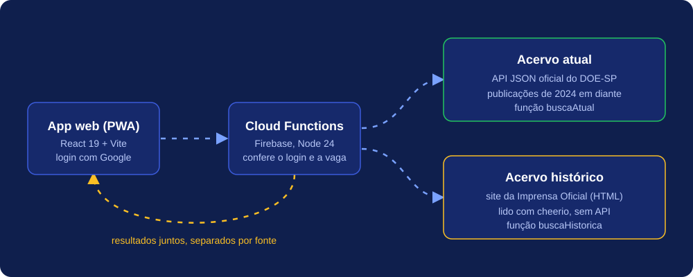
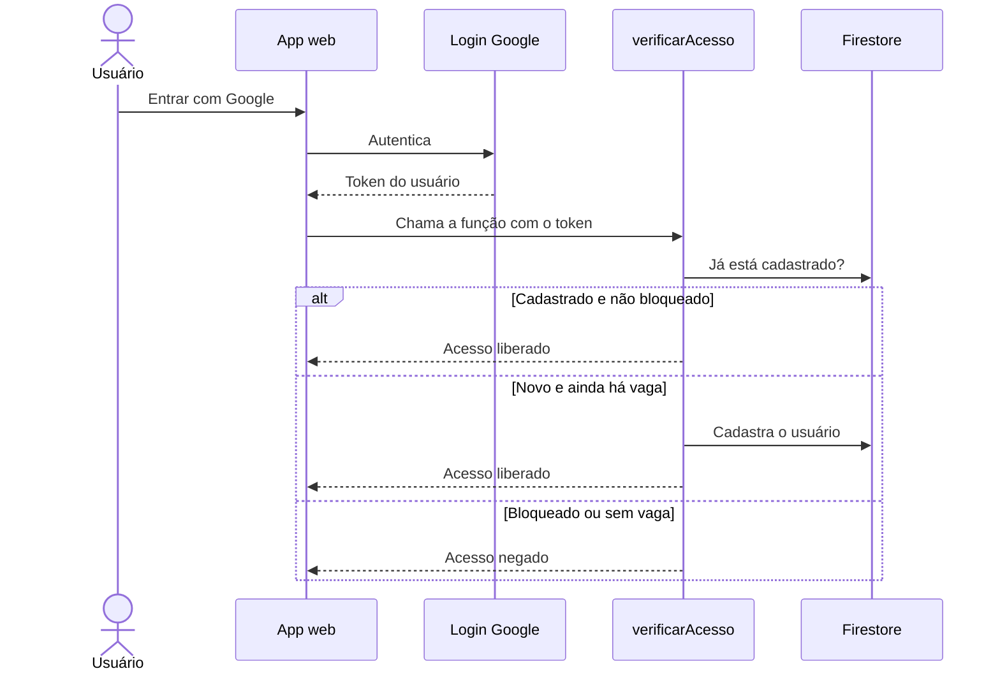

<p align="center">
  
</p>

<p align="center">
  <a href="https://busca.olloapp.com.br"></a>
</p>

<p align="center">
  
  
  
  
  
  
</p>

---

## O que é

O **Busca DO-SP** procura o nome de uma pessoa (ou um termo) no **Diário Oficial do Estado de São Paulo** e mostra tudo em uma tela só: publicações recentes e registros históricos, com o link do documento oficial.

Ele foi criado para os servidores da Educação da **E.E. Prof. Simão Mathias**, que antes precisavam consultar duas fontes diferentes e ler PDFs longos para saber se saiu uma publicação sobre licença, quinquênio ou evolução funcional.

> **Acesso restrito:** o login é feito com conta Google e há um limite configurável de usuários autorizados.

## Funcionalidades

| Recurso | O que faz |
| --- | --- |
| **Busca em duas fontes** | Consulta o acervo atual (2024 em diante) e o acervo histórico ao mesmo tempo e separa os resultados por fonte. |
| **Filtros por assunto** | Licença Saúde, Readaptação, Quinquênio, Licença Prêmio, Evolução Funcional e Efetivo Exercício, cada um com cor e ícone próprios. |
| **Períodos de busca** | Últimos 6 meses, 1 ano (padrão), 5 anos, todo o acervo histórico ou datas personalizadas. |
| **Explicação em linguagem simples** | A IA resume o que a publicação significa em poucas frases, sem inventar nada além do texto original. |
| **Minhas Listas** | Salve pessoas em listas (como "Favoritos") e veja um aviso de **novo** quando sair uma publicação, com resumo gerado pela IA. |
| **Histórico de buscas** | Cada usuário tem o seu, privado. |
| **Compartilhar no WhatsApp** | Envia o resultado já com o nome da pessoa pesquisada. |
| **Painel de administrador** | Define o limite de usuários, bloqueia e desbloqueia contas e consulta o histórico de cada uma. |
| **PWA e tema** | Pode ser instalado no celular e tem modo claro e escuro. |

## Fontes de dados do Diário Oficial

O Diário Oficial de SP não tem uma única API que cubra tudo, então o projeto combina duas fontes:

<p align="center">
  
</p>

| | Acervo atual | Acervo histórico |
| --- | --- | --- |
| **Período** | 2024 em diante | Antes de 2024 |
| **Origem** | API JSON oficial do DOE-SP (`do-api-web-search.doe.sp.gov.br`) | Site da Imprensa Oficial (`imprensaoficial.com.br`) |
| **Como é lido** | Requisição direta, com resultados paginados | Leitura do formulário de busca do site (HTML) com **cheerio** |
| **Função** | `buscaAtual` | `buscaHistorica` |

Como o acervo histórico depende da estrutura de um site, ele é a parte mais sensível a mudanças. Se o site da Imprensa Oficial mudar, a `buscaHistorica` é o primeiro lugar para ajustar.

## Tecnologias

| Camada | Tecnologias |
| --- | --- |
| **Front-end** | React 19, Vite 8, React Router 7, Lucide Icons, `vite-plugin-pwa` |
| **Back-end** | Firebase Cloud Functions (2ª geração, Node 24), axios, cheerio |
| **Autenticação** | Firebase Authentication com login Google |
| **Banco de dados** | Cloud Firestore (região `southamerica-east1`) |
| **Inteligência artificial** | API da Anthropic, modelo Claude Haiku 4.5 |
| **Hospedagem** | Firebase Hosting, com domínio próprio `busca.olloapp.com.br` |
| **Qualidade** | ESLint |

## Banco de dados

O Firestore guarda poucos dados, e as regras de segurança bloqueiam por padrão tudo o que não está listado.

| Coleção | O que guarda | Quem acessa |
| --- | --- | --- |
| `usuarios_autorizados/{uid}` | E-mail, se está bloqueado e quando entrou | O próprio usuário só lê. Quem escreve é a Cloud Function. |
| `usuarios_autorizados/{uid}/buscas` | Histórico de buscas e itens salvos nas listas | Somente o dono |
| `usuarios_autorizados/{uid}/meta` | Nomes das listas personalizadas | Somente o dono |
| `config/acesso` | Limite de usuários permitidos | Somente as Cloud Functions |
| `explicacoes_ia/{id}` | Explicações da IA já geradas, reaproveitadas para economizar chamadas | Somente as Cloud Functions |

## Como o acesso é controlado



## Estrutura do projeto

<details>
<summary><strong>Ver as pastas</strong></summary>

```text
busca-do-sp/
├── src/                    App React
│   ├── pages/              Login, Home e painel Admin
│   ├── components/         Busca, resultados, listas e histórico
│   ├── hooks/              useSearch, useHistoricoBuscas, useTema
│   ├── services/           Chamadas às Cloud Functions
│   ├── config/             Assuntos, cores e frases
│   └── firebase/           Configuração do Firebase
├── functions/              Cloud Functions (Node 24)
│   ├── buscaAtual.js       API oficial do DOE-SP
│   ├── buscaHistorica.js   Acervo histórico (cheerio)
│   ├── acesso.js           Login e limite de vagas
│   ├── admin.js            Painel de administrador
│   ├── explicarPublicacao.js   Explicação por IA
│   └── resumirNovidades.js     Resumo de novidades por IA
├── public/                 Ícones do PWA
├── firestore.rules         Regras de segurança
└── firebase.json           Hosting, Functions e Firestore
```

</details>

## Como rodar

<details>
<summary><strong>Passo a passo para desenvolvimento</strong></summary>

Você vai precisar de Node.js e de um projeto Firebase no plano **Blaze**, porque as Cloud Functions não funcionam no plano gratuito (Spark).

```bash
# 1. Clonar e instalar
git clone https://github.com/Thiago-spba/busca-do-sp.git
cd busca-do-sp
npm install
cd functions
npm install
cd ..

# 2. Rodar o app
npm run dev
```

Depois:

1. Coloque a configuração web do seu projeto em `src/firebase/config.js`.
2. Ative o login Google em **Authentication** no console do Firebase.
3. Guarde a chave da Anthropic como segredo (nunca no código):

```bash
firebase functions:secrets:set ANTHROPIC_API_KEY --project SEU-PROJETO
```

</details>

<details>
<summary><strong>Publicar (deploy)</strong></summary>

```bash
npm run build
firebase deploy --project SEU-PROJETO
```

Para publicar só as funções:

```bash
firebase deploy --only functions --project SEU-PROJETO
```

</details>

## Segurança

- **Login Google** obrigatório, com verificação feita no servidor a cada busca.
- **Regras do Firestore** restritivas: cada pessoa só lê e escreve os próprios dados.
- **Autorização só pelo servidor:** o navegador não consegue se cadastrar nem se desbloquear.
- **Chave da IA no Secret Manager**, fora do código e fora do repositório.
- **Limite de usuários** e bloqueio de contas pelo painel de administrador.

## Autor

Desenvolvido por **Thiago**, professor e desenvolvedor, para a comunidade escolar da E.E. Prof. Simão Mathias.

<p align="center">
  <a href="https://busca.olloapp.com.br"><strong>busca.olloapp.com.br</strong></a>
</p>
